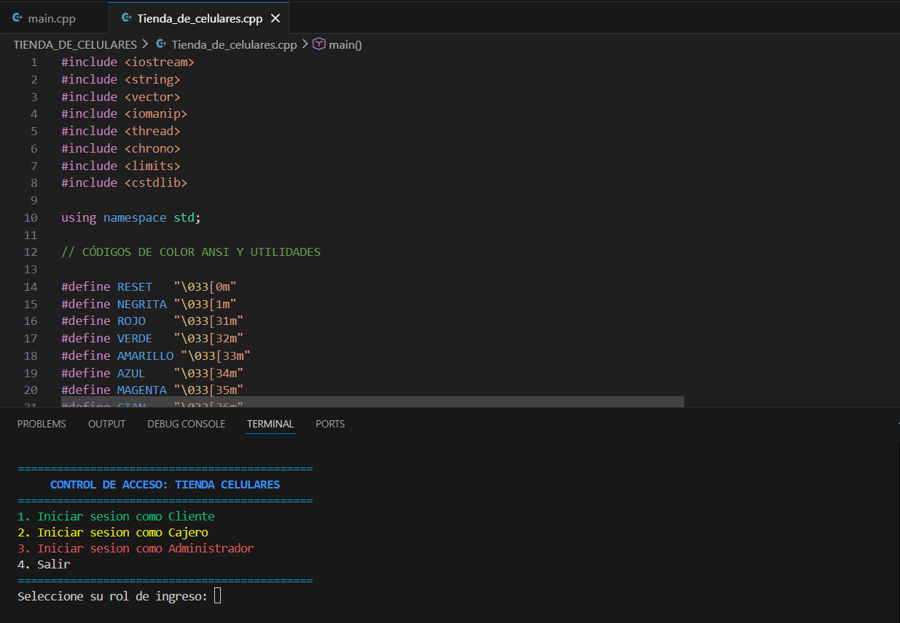
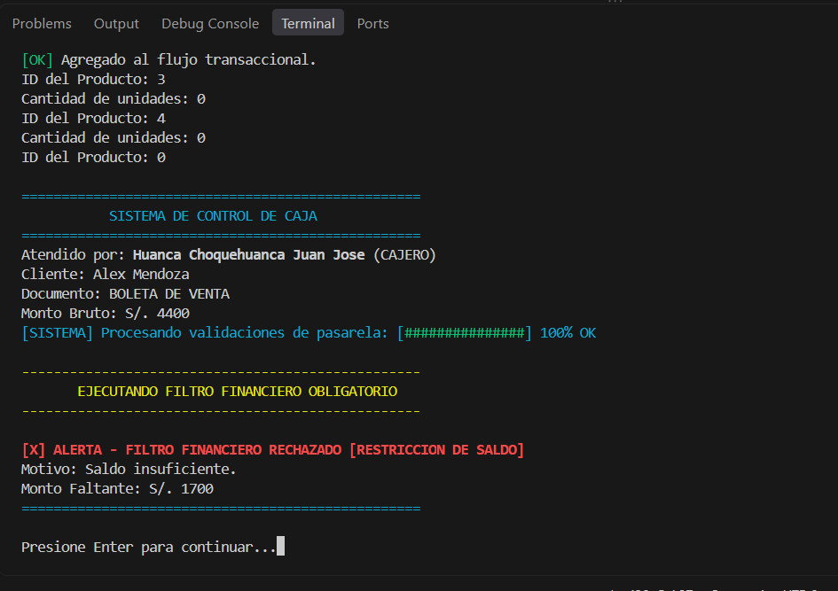
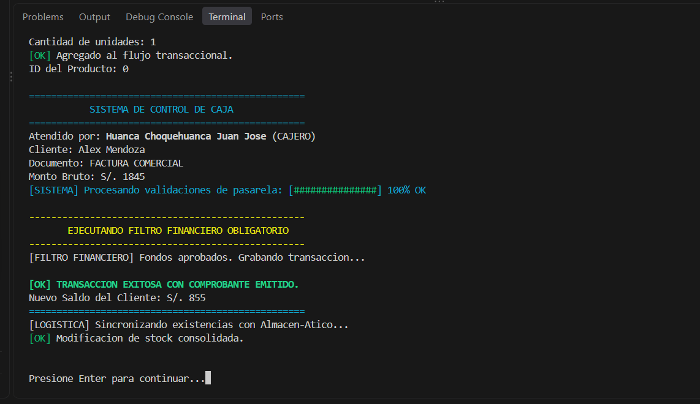
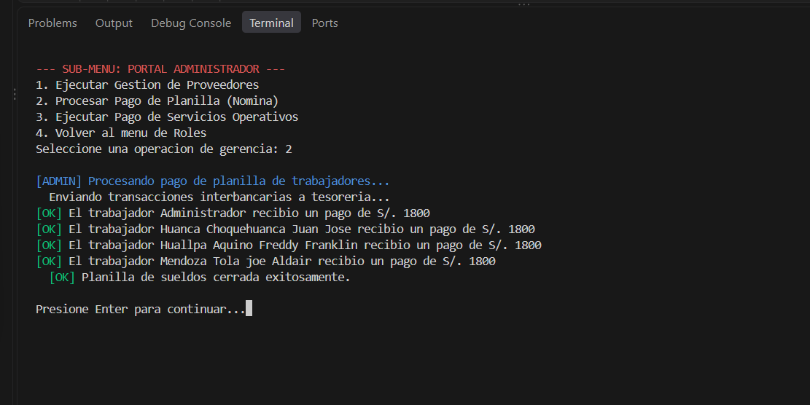

#  Sistema de Gestión Integral para Tienda de Celulares

Este repositorio contiene el código fuente del proyecto final de la primera unidad para el curso de **Programación Orientada a Objetos I**. Consiste en un sistema transaccional y administrativo por consola, desarrollado en C++, diseñado para gestionar las ventas, el inventario y el personal de una tienda de dispositivos móviles.

## Integrantes del Equipo
* Huanca Choquehuanca Juan Jose
* Huallpa Aquino Freddy Franklin
* Mendoza Tola Joe Aldair

## Características Técnicas (POO)
* **Herencia y Abstracción:** Implementación de clases abstractas (`Persona`, `Producto`) con clases derivadas (`Cliente`, `Trabajador`, `Celular`, `Accesorios`).
* **Polimorfismo:** Uso de métodos virtuales puros (`mostrarFicha()`) para gestionar un catálogo mixto de productos mediante un arreglo de punteros (`vector<Producto*>`).
* **Gestión Dinámica de Memoria:** Uso de punteros, asignación de memoria (`new`) y liberación segura con destructores virtuales para evitar *memory leaks*.
* **Lógica Transaccional:** Filtro Financiero que valida el presupuesto del cliente antes de concretar una compra.
* **Enums:** Tipos de datos restringidos para roles (`CAJERO`, `ADMINISTRADOR`), pantallas (`IPS`, `AMOLED`, `OLED`) y comprobantes (`BOLETA`, `FACTURA`).
* **Interfaz (UX):** Uso de la librería `<thread>` para animaciones de carga (barras de progreso y efecto máquina de escribir) y colores ANSI en consola.

---

## Instrucciones de Compilación y Ejecución

El proyecto está conformado por un único archivo fuente (`Tienda_de_celulares.cpp`). Puedes compilarlo de las siguientes maneras:

### Opción 1: Usando Visual Studio Code (Recomendado)
1. Abre la carpeta del proyecto en VS Code.
2. Asegúrate de tener instalada la extensión **C/C++** (de Microsoft) y el compilador **MinGW/GCC**.
3. Abre el archivo `Tienda_de_celulares.cpp`.
4. Presiona el botón de **"Play"** (Run Code) en la esquina superior derecha, o usa el atajo `Ctrl + F5`.
5. *Nota para Windows:* Si el botón de Play da error por una configuración previa, usa la Opción 2 (Terminal).

### Opción 2: Usando la Terminal (CMD, PowerShell o Linux/Mac)
1. Abre tu terminal en la carpeta donde se encuentra el archivo `.cpp`.
2. Compila el código usando
```bash
g++ Tienda_de_celulares.cpp -o tienda.exe
```
3. Ejecuta el programa:
* En **Windows**: `.\tienda.exe`
* En **Linux\Mac**: `./tienda.exe`

---
## Notas sobre los Colores y la Consola
Si los textos de colores (rojo, verde, cian) se ven con símbolos extraños (ej. `←[31m`) en Windows, sigue estos pasos antes de ejecutar el programa:
1. Abre PowerShell o CMD.
2. Ejecuta el siguiente comando para forzar la codificación UTF-8:
 ```bash
chcp 65001
```
4. Vuelve a ejecutar el programa y los colores se verán perfectos.

---


---

## Demostración del Sistema (Evidencia de Ejecución)

### 1. Menú Principal y Control de Roles


### 2. Validación del Filtro Financiero
El sistema bloquea la transacción si el cliente no cuenta con el saldo suficiente.


### 3. Transacción Exitosa y Actualización de Stock


### 4. Módulo de Administración (Pago de Nómina)


---
##  Video de Exposición
Puedes ver la exposición desarrollada sobre el código aquí:
 **[https://youtu.be/l1CCZJ57hzg?si=0CN59KjMH5cGrYht](AQUÍ_PEGAS_EL_ENLACE_DE_TU_VIDEO)**
